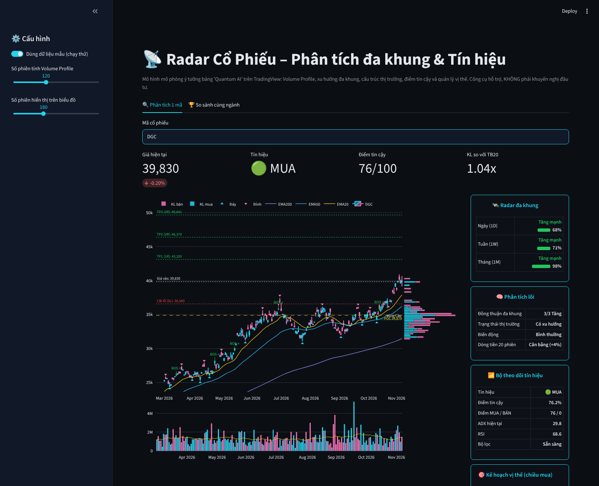

# Radar Cổ Phiếu – Phân tích đa khung & Tín hiệu

App Streamlit mô phỏng ý tưởng bảng "Quantum AI" (TradingView) cho cổ phiếu Việt Nam.



## Các khối chức năng
| Khối | Nội dung |
|---|---|
| Biểu đồ nến | EMA20/50/200, đỉnh/đáy swing, BOS/CHoCH, vùng Cung/Cầu, POC |
| Volume Profile | Khối lượng xếp chồng theo vùng giá, tách mua (xanh) / bán (hồng) |
| Radar đa khung | Xu hướng & sức mạnh khung Ngày / Tuần / Tháng |
| Phân tích lõi | Đồng thuận đa khung, trạng thái thị trường (ADX), nén biến động (Squeeze), dòng tiền 20 phiên |
| Bộ theo dõi tín hiệu | MUA / BÁN / CHỜ, điểm tin cậy 0–100, bộ lọc |
| Kế hoạch vị thế | Giá vào, cắt lỗ theo ATR, TP1–TP3 (1R/2R/3R) |
| Sức khỏe doanh nghiệp (FA) | ROE, tăng trưởng lợi nhuận, P/E, Nợ/Vốn chủ, P/B → điểm /50, xếp hạng A-B-C-D |
| **Tổng điểm 100** | FA (50) + Kỹ thuật (50) → Ưu tiên giải ngân / Theo dõi / Trung tính / Tránh |
| So sánh ngành | Xếp hạng nhiều mã theo tổng điểm |

## Thang điểm cơ bản FA (50)
ROE 15 · Tăng trưởng LNST 10 · P/E 10 · Nợ/Vốn chủ 10 · P/B 5.
Thiếu chỉ tiêu nào → cho nửa số điểm (trung tính). Ngân hàng (Nợ/Vốn chủ > 5) không bị trừ điểm nợ.

## Tổng điểm (100)
| Tổng điểm | Đánh giá |
|---|---|
| ≥ 75 | 🟢 Ưu tiên giải ngân |
| 60–74 | 🔵 Theo dõi sát, chờ điểm mua |
| 45–59 | 🟡 Trung tính |
| < 45 | 🔴 Tránh / hạ tỷ trọng |

## Thang điểm tin cậy kỹ thuật (100, quy về 50 trong tổng điểm)
Đồng thuận đa khung 30 · EMA xếp hướng 15 · ADX/DI 15 · Dòng tiền 15 · RSI 10 · Cấu trúc BOS 10 · KL đột biến 5.
Tín hiệu MUA cần ≥ 65 điểm **và** bộ lọc đạt (ADX ≥ 20, không đang nén).

## Đưa app lên mạng miễn phí (Streamlit Community Cloud)
1. Vào https://share.streamlit.io → đăng nhập bằng tài khoản GitHub.
2. Bấm **Create app** → chọn repo `app-danh-gia-chung-khoan-2026`, nhánh chứa code, file `app.py`.
3. Bấm **Deploy**, đợi 3–5 phút. Xong sẽ có đường link mở được trên điện thoại / máy tính.

## Chạy trên máy tính
```
pip install -r requirements.txt
streamlit run app.py
```
Không có mạng / nguồn dữ liệu lỗi → bật "Dùng dữ liệu mẫu" ở thanh bên.

⚠️ Công cụ hỗ trợ, không phải khuyến nghị đầu tư.
